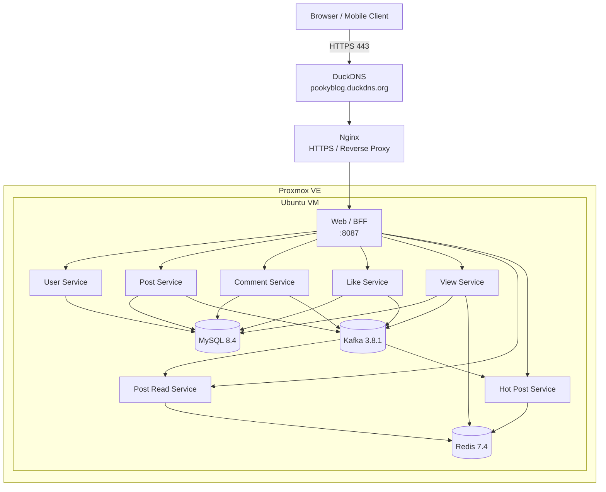
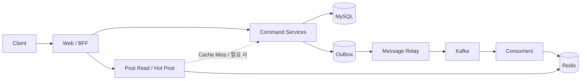

# 📖 PookyBlog: 확장성과 성능을 고려한 이벤트 기반 블로그 시스템

**PookyBlog**는 이벤트 기반 백엔드 아키텍처를 중심으로 시작해, 실제 사용자 흐름과 운영 환경까지 검증하며 **Web/BFF, UI/UX, 인프라 배포까지 확장한 개인 프로젝트**입니다.

서비스 단위의 멀티 모듈 구조에서 **CQRS**, **Transactional Outbox**, **Kafka**, **Redis**를 적용했으며, 단순 기능 구현에 그치지 않고 실제 배포 환경에서 발생한 **성능·데이터 정합성·사용자 경험·운영 장애 문제를 직접 확인하고 개선하는 것**을 목표로 하고 있습니다.

## 🌐 Live Demo

> **배포 주소:** https://pookyblog.duckdns.org

Ubuntu VM에서 Docker Compose로 서비스 중이며 Nginx Reverse Proxy와 HTTPS를 적용했습니다.

### 👤 면접관용 테스트 계정

| 항목 | 값 |
| --- | --- |
| ID | `interviewer` |
| Password | `interviewer123` |

> 포트폴리오 기능 확인을 위한 전용 계정입니다. 게시글/댓글 작성, 좋아요 등 주요 기능을 자유롭게 테스트할 수 있습니다.

## ✅ 주요 기능

- 회원가입 / 로그인 / 로그아웃 및 JWT 기반 인증
- 게시글 목록 / 상세 조회 / 작성 / 수정 / 삭제
- 댓글 조회 / 작성 / 수정 / 삭제
- 좋아요 / 좋아요 취소 / 좋아요 수 조회
- Redis 기반 조회수 집계 및 동일 사용자·게시글 조합의 단시간 중복 증가 방지
- CQRS 기반 Redis 조회 모델
- Kafka 이벤트 기반 비동기 처리
- Transactional Outbox + Message Relay 기반 이벤트 발행
- Redis Sorted Set 기반 실시간 인기 게시글 랭킹
- 커버링 인덱스를 활용한 게시글 목록 조회 성능 개선
- 실제 서비스 형태의 반응형 UI/UX
- MVC 페이지와 API의 오류 응답 분리 및 404 / 500 전용 화면

배포 환경에서 회원가입부터 게시글 작성, 조회, 좋아요, 댓글, 수정, 삭제, 인기글 반영, 404 처리까지 주요 사용자 흐름을 직접 E2E로 검증했습니다.

---

## ✨ 최근 서비스 고도화

초기 PookyBlog는 백엔드 아키텍처와 대용량 트래픽 대응 설계에 초점을 둔 프로젝트였기 때문에 실제 사용자 관점의 화면 구성과 서비스 완성도는 상대적으로 부족했습니다.

이를 개선하기 위해 기존 **Spring MVC + Mustache 구조를 유지하면서**, 단순 Bootstrap 형태의 화면을 실제 서비스에 가까운 형태로 고도화했습니다.

### UI/UX 개선

- 홈 화면을 최근 게시글과 인기 게시글 중심으로 재구성
- 기존 테이블 중심 게시글 목록을 카드형 UI로 개선
- 게시글 상세 화면의 가독성과 정보 구조 개선
- 글 작성 / 수정 폼의 입력 UX 개선
- 로그인 여부에 따른 UI 동작 정리
- Empty State / Error State 구현
- 404 / 500 전용 에러 페이지 구현
- Desktop / Tablet / Mobile 반응형 UI 적용
- 키보드 Focus 등 기본적인 접근성 개선

단순히 화면 스타일만 변경하지 않고 기존 백엔드 기능을 실제 사용자 화면과 연결했습니다.

```text
Recent Posts     → Post Service
View Count       → View Service
Like State/Count → Like Service
Comments         → Comment Service
Trending         → Hot Post Service
```

### 실제 데이터 기반 Trending

홈 화면의 `Trending Today`는 mock 데이터가 아니라 Kafka 이벤트와 Redis를 이용해 실제 서비스 데이터로 집계합니다.

현재 인기 점수는 다음과 같이 계산합니다.

```text
Hot Score
= 좋아요 수 × 3
+ 댓글 수 × 2
+ 조회수 × 1
```

게시글의 좋아요·댓글·조회 이벤트가 Kafka를 통해 Hot Post Service로 전달되면 점수를 다시 계산합니다.

오늘 생성된 게시글만 인기글 후보로 반영하며, Redis Sorted Set에 날짜별 랭킹을 관리합니다.

```text
Like / Comment / View Event
            ↓
          Kafka
            ↓
     Hot Post Consumer
            ↓
좋아요 / 댓글 / 조회수 집계
            ↓
     Hot Score 계산
            ↓
 Redis Sorted Set
 hot-post::list::{yyyyMMdd}
            ↓
       상위 10개 유지
```

인기글 데이터의 TTL은 10일이며, 홈 화면에서는 점수 순으로 정렬된 결과를 노출합니다.

### 운영 환경 E2E 검증

UI 개선 이후 단위 테스트에 그치지 않고 실제 운영 URL에서 다음 사용자 흐름을 직접 검증했습니다.

```text
회원가입
  ↓
로그인
  ↓
게시글 작성
  ↓
게시글 상세 조회
  ↓
조회수 증가
  ↓
좋아요
  ↓
댓글 작성
  ↓
게시글 수정
  ↓
Trending 반영
  ↓
좋아요 + 댓글이 존재하는 게시글 삭제
  ↓
삭제된 게시글 URL → HTTP 404
  ↓
전용 404 페이지 렌더링
```

이 과정에서 UI뿐 아니라 서비스 간 데이터 정합성 및 운영 환경의 문제도 함께 발견하고 수정했습니다.

---

## 🚢 실제 배포 구조 (Deployment Architecture)



외부에서는 **Nginx를 통해 Web/BFF만 접근 가능**하고 각 서비스와 MySQL/Redis/Kafka는 Docker 내부 네트워크에서 통신합니다.

### 운영 및 자동 복구 구성

- Docker Compose 서비스에 `restart: unless-stopped` 적용
- MySQL / Redis / Kafka Health Check 적용
- 애플리케이션 서비스는 인프라 서비스의 healthy 상태 이후 기동
- MySQL / Redis / Kafka 데이터 Docker Volume 영속화
- Nginx Reverse Proxy를 통한 외부 진입점 단일화
- Let's Encrypt 인증서 기반 HTTPS 및 Certbot 자동 갱신 구성
- DuckDNS 기반 도메인 및 동적 공인 IP 대응

`compose.yaml`의 재시작 정책에 따라 Docker daemon 재기동 시 컨테이너가 다시 기동하도록 구성했습니다.

---

## 🛠️ 기술 스택 (Tech Stack)


---

## 🏗️ 프로젝트 구조 (Project Structure)

서비스별 책임을 분리한 멀티 모듈 구조입니다.

```text
.
├── common
│   ├── outboxmessage   # Transactional Outbox / Message Relay
│   └── snowflake       # 분산 ID 생성
├── services
│   ├── comment
│   ├── hot-post
│   ├── like
│   ├── post
│   ├── post-read       # CQRS 조회 모델
│   ├── user
│   └── view
├── web                 # 외부 요청을 처리하는 Web/BFF
├── compose.yaml
├── Dockerfile
└── build.gradle
```

---

## 🏛️ 시스템 아키텍처 (System Architecture)

쓰기 서비스에서 발생한 변경 이벤트를 Outbox에 함께 기록하고 Message Relay가 Kafka로 발행합니다.

Consumer는 이벤트를 비동기로 처리하여 Redis 기반 조회 모델과 인기 게시글 데이터를 갱신합니다.

따라서 Command 데이터와 Redis의 파생 데이터 사이에는 짧은 시간의 **eventual consistency**가 존재할 수 있습니다.



1. Command 서비스의 데이터 변경과 Outbox 이벤트 저장을 같은 트랜잭션 범위에서 처리합니다.
2. Message Relay가 저장된 Outbox 이벤트를 Kafka로 발행합니다.
3. Consumer가 이벤트를 비동기로 소비해 Redis의 조회/랭킹 데이터를 갱신합니다.
4. 조회 경로는 Redis를 활용해 원본 DB 및 서비스에 집중되는 조회 부하를 분산합니다.

---

## 🗃️ 데이터 모델링

PookyBlog는 user, post, comment, like, view 등 기능을 서비스 단위로 분리하고 있으므로 README에서 하나의 관계형 DB처럼 모든 도메인을 FK로 연결한 ERD를 제시하지 않습니다.

서비스 간에는 `userId`, `postId` 등의 식별자를 이용해 연계하며, 조회에 필요한 파생 데이터는 Redis와 이벤트를 통해 관리합니다.

대표적인 동시성 제어 대상인 `LikeCount`는 게시글 ID를 키로 좋아요 수를 관리하며 JPA `@Version` 필드를 가지고 있습니다.

실제 repository에는 `PESSIMISTIC_WRITE` 조회와 원자적 증가/감소 update query도 구현되어 있어 동시성 제어 방식을 비교·적용할 수 있도록 구성되어 있습니다.

---

## 🚀 주요 기술 및 성과 (Key Features & Achievements)

| 구분 | 문제 정의 | 적용 및 결과 |
| --- | --- | --- |
| **CQRS** | 조회 시 원본 서비스/DB에 부하가 집중될 수 있는 문제 | Redis 조회 모델을 별도로 두어 조회 경로를 분리하고 DB 조회 부하를 분산 |
| **이벤트 기반 아키텍처** | 인기글·조회 모델 갱신 로직이 핵심 쓰기 로직과 강하게 결합되는 문제 | Transactional Outbox + Message Relay + Kafka로 이벤트를 비동기 전달하고 Redis Sorted Set으로 인기글 관리 |
| **좋아요 동시성 제어** | 동시에 좋아요 수를 변경할 때 발생할 수 있는 경쟁 상태 | `@Version` 기반 낙관적 락 구조, `PESSIMISTIC_WRITE`, 원자적 update query 등 동시성 제어 방식을 구현·비교 |
| **게시글 목록 성능 개선** | 데이터 증가에 따른 목록 조회 성능 저하 | 커버링 인덱스 적용 테스트에서 실행 시간 **21.97초 → 6.85초(약 69% 감소)** |
| **조회수 DB 쓰기 감소** | 조회마다 DB를 갱신할 경우 발생하는 쓰기 부하 | Redis에서 조회수를 증가시키고 **100회 단위**로 DB에 backup. 동일 사용자·게시글은 **10초 TTL lock**으로 중복 증가 방지 |
| **BFF / Reverse Proxy 안정화** | downstream hop-by-hop header 중복 전달로 Nginx `502 Bad Gateway` 발생 | downstream `ResponseEntity`를 그대로 전달하지 않고 status/body 기반으로 재생성하고 로그인은 `Set-Cookie`만 선택 전달 |
| **삭제 정합성 개선** | 좋아요·댓글이 존재하는 게시글 삭제 시 FK 제약으로 실패 | FK 정책을 `ON DELETE CASCADE`로 변경하고 운영 DB migration 적용 |
| **사용자 오류 경험 개선** | 삭제된 게시글 접근 시 브라우저에 JSON 오류가 그대로 노출 | API JSON 오류 계약과 MVC HTML 오류 처리를 분리하고 404 / 500 전용 UI 적용 |
| **운영 장애 복구** | VM 디스크 100%로 Git·Redis·Kafka 장애 발생 | Docker Build Cache 정리, Redis AOF 복구, Kafka 재기동 후 전체 서비스 정상화 |

> 성능 수치는 프로젝트에서 수행한 특정 테스트 결과이며 운영 환경 전체의 처리량이나 모든 데이터 규모에서 동일한 개선율을 보장한다는 의미는 아닙니다.

---

# 🧯 Trouble Shooting

## 1. Nginx 502 - duplicate `Transfer-Encoding: chunked`

### 문제

Web/BFF가 WebClient로 받은 downstream 응답의 hop-by-hop header까지 외부 응답에 전달하면서 Servlet Container가 생성한 `Transfer-Encoding`과 중복되어 Nginx가 `502 Bad Gateway`를 반환했습니다.

### 해결

- downstream `ResponseEntity`를 그대로 반환하지 않고 status/body 기반으로 새로운 응답 생성
- `Transfer-Encoding`, `Content-Length`, `Connection` 등의 downstream hop-by-hop header 미전파
- 로그인은 인증에 필요한 `Set-Cookie`만 선택적으로 전달
- downstream 4xx의 `code`, `message`는 보존하면서 내부 stack trace는 노출하지 않도록 처리
- 기존 JWT / Authorization request relay 유지

### 검증

- `./gradlew :web:test` 성공
- hop-by-hop header 미전파 / 로그인 `Set-Cookie` 전달 회귀 테스트 추가
- 실제 배포 환경의 주요 사용자 흐름 E2E 정상 동작 확인

---

## 2. 좋아요·댓글이 존재하는 게시글 삭제 실패

### 문제

게시글에 좋아요 또는 댓글이 존재하는 상태에서 게시글을 삭제하면 MySQL FK 제약 조건으로 인해 삭제가 실패했습니다.

```text
post_like.post_id → post.id
comment.post_id   → post.id
```

기존 FK에는 `ON DELETE CASCADE`가 적용되어 있지 않아 부모 게시글을 먼저 삭제할 수 없었습니다.

### 해결

게시글에 직접 종속되는 `post_like`, `comment`의 FK 정책을 `ON DELETE CASCADE`로 변경했습니다.

```text
post 삭제
   ├── post_like 자동 삭제
   └── comment 자동 삭제
```

신규 스키마에는 Entity Mapping으로 동일한 정책을 적용하고, 이미 존재하는 운영 DB에는 별도의 migration SQL을 작성했습니다.

```text
db/migrations/20261016_post_delete_cascade.sql
```

`ddl-auto:update`만으로는 기존 FK 정책이 변경되지 않기 때문에 운영 DB를 백업한 후 migration을 직접 적용했습니다.

### 검증

- 좋아요가 없는 게시글 삭제
- 좋아요가 존재하는 게시글 삭제
- 댓글이 존재하는 게시글 삭제
- 좋아요 + 댓글이 동시에 존재하는 게시글 삭제
- 삭제 후 종속 row 제거 확인
- 삭제된 게시글 상세 URL → HTTP 404 확인

---

## 3. API 404는 정상이지만 브라우저에 JSON 오류가 노출되는 문제

### 문제

삭제된 게시글 URL에 접근하면 HTTP Status 자체는 `404`였지만 사용자는 전용 에러 화면이 아닌 다음과 같은 JSON 응답을 보게 되었습니다.

```json
{
  "code": "404",
  "message": "내부 서비스가 요청을 처리하지 못했습니다."
}
```

원인은 API 프록시 요청을 위한 전역 `RestControllerAdvice`가 MVC 페이지 요청의 downstream 오류까지 JSON 형태로 처리하고 있었기 때문입니다.

### 해결

오류 처리 책임을 분리했습니다.

```text
/api/** 요청
   ↓
DownstreamExceptionHandler
   ↓
JSON ErrorResponse 유지

MVC Page 요청
   ↓
PageExceptionHandler
   ↓
404.mustache / 500.mustache
```

API 응답 계약은 그대로 유지하면서 사용자가 브라우저에서 접근하는 페이지 요청에 대해서만 기존 Mustache 에러 페이지를 렌더링하도록 변경했습니다.

### 검증

- 존재하지 않는 게시글 상세 → HTTP 404 + HTML 404 페이지
- 존재하지 않는 게시글 수정 URL → HTTP 404
- MVC 내부 오류 → HTTP 500 페이지
- `/api/**` downstream 오류 → 기존 JSON ErrorResponse 유지
- `:web:test` **45개 테스트 통과**
- 실제 DuckDNS 운영 환경에서 삭제된 게시글 URL의 404 화면 확인

---

## 4. VM 디스크 100%로 인한 Redis / Kafka 장애

### 문제

운영 Ubuntu VM의 루트 디스크 사용률이 100%에 도달하면서 여러 문제가 동시에 발생했습니다.

```text
VM Disk 100%
   ├── Git index.lock write 실패
   ├── Redis AOF 손상
   └── Kafka snapshot write 실패
```

실제 로그에서는 다음 오류가 발생했습니다.

```text
Git
→ Out of diskspace

Redis
→ Bad file format reading the append only file

Kafka
→ No space left on device
```

Redis와 Kafka는 정상적으로 시작하지 못하고 restart loop에 진입했습니다.

### 원인 분석

Docker의 디스크 사용량을 확인했습니다.

```bash
docker system df
```

그 결과 Docker Build Cache가 약 **11.65GB** 누적되어 있었으며 이 중 약 **9.99GB**를 회수할 수 있는 상태였습니다.

사용하지 않는 Build Cache를 정리해 VM의 디스크 사용률을 복구했습니다.

```text
Disk Usage
100% → 78%
```

### Redis 데이터 복구

Redis는 디스크 부족 상태에서 AOF 파일 마지막 영역이 손상되어 있었습니다.

Redis Docker Volume 전체를 먼저 백업한 뒤 `redis-check-aof`로 AOF 무결성을 검사했습니다.

```text
AOF Size : 52,912,128 bytes
Valid    : 52,912,079 bytes
Damage   : 49 bytes
```

손상된 마지막 **49 bytes**만 truncate하여 복구했습니다.

복구 후:

```bash
redis-cli ping
```

```text
PONG
```

응답을 확인했습니다.

### Kafka 복구

Kafka 역시 디스크 부족으로 producer snapshot을 기록하지 못하면서 종료되었습니다.

저장 공간을 확보한 뒤 재기동하고 Health Check 및 Consumer 연결 상태를 확인했습니다.

### 최종 검증

```text
MySQL  → healthy
Redis  → healthy
Kafka  → healthy
Web    → HTTP 200
Nginx  → configuration test successful
HTTPS  → HTTP 200
```

장애 복구 이후 전체 서비스를 재배포하고 실제 사용자 흐름을 다시 E2E로 검증했습니다.

---

## 🧪 테스트

```bash
./gradlew :web:test
./gradlew test
```

주요 회귀 테스트 범위:

- BFF hop-by-hop 응답 헤더 미전파
- 로그인 성공 시 `Set-Cookie` 전달
- 로그인 오류의 공통 예외 처리
- downstream 4xx `code`, `message` 보존
- API JSON 오류와 MVC HTML 오류 처리 분리
- 존재하지 않는 게시글 상세 / 수정 페이지 404
- MVC 500 오류 페이지
- JWT / Authorization relay 유지
- CQRS / 인기글 / 동시성 관련 모듈 테스트

단위 테스트뿐 아니라 실제 운영 URL에서도 주요 사용자 흐름을 검증했습니다.

```text
https://pookyblog.duckdns.org
```

---

## ✍️ 기술 탐구 기록 (Technical Deep Dive on Blog)

프로젝트를 진행하며 마주한 기술적 문제와 해결 과정, 설계에 대한 고민을 블로그에 기록하고 있습니다.

### 아키텍처 및 성능 최적화

- [CQRS 패턴 적용기: 게시글 상세 조회 API 성능 최적화](https://blog.naver.com/hyundho12/223943254609)
- [커버링 인덱스를 이용한 API 성능 개선 (69% 개선)](https://blog.naver.com/hyundho12/223843326026)

### 데이터 정합성 및 동시성

- [좋아요 기능 동시성 문제 해결기 (비관적/낙관적 락)](https://blog.naver.com/hyundho12/223856034147)
- [Redis 분산 락을 이용한 조회수 중복 증가 방지](https://blog.naver.com/hyundho12/223922953575)

### 이벤트 기반 시스템 설계

- [Outbox 패턴으로 메시지 유실 방지하기](https://blog.naver.com/hyundho12/223925280341)
- [Kafka와 Redis를 이용한 실시간 인기글 기능 구현 (1)](https://blog.naver.com/hyundho12/223929854775)
- [Kafka와 Redis를 이용한 실시간 인기글 기능 구현 (2)](https://blog.naver.com/hyundho12/223933728929)
- [Kafka와 Redis를 이용한 실시간 인기글 기능 구현 (3)](https://blog.naver.com/hyundho12/223936487540)
